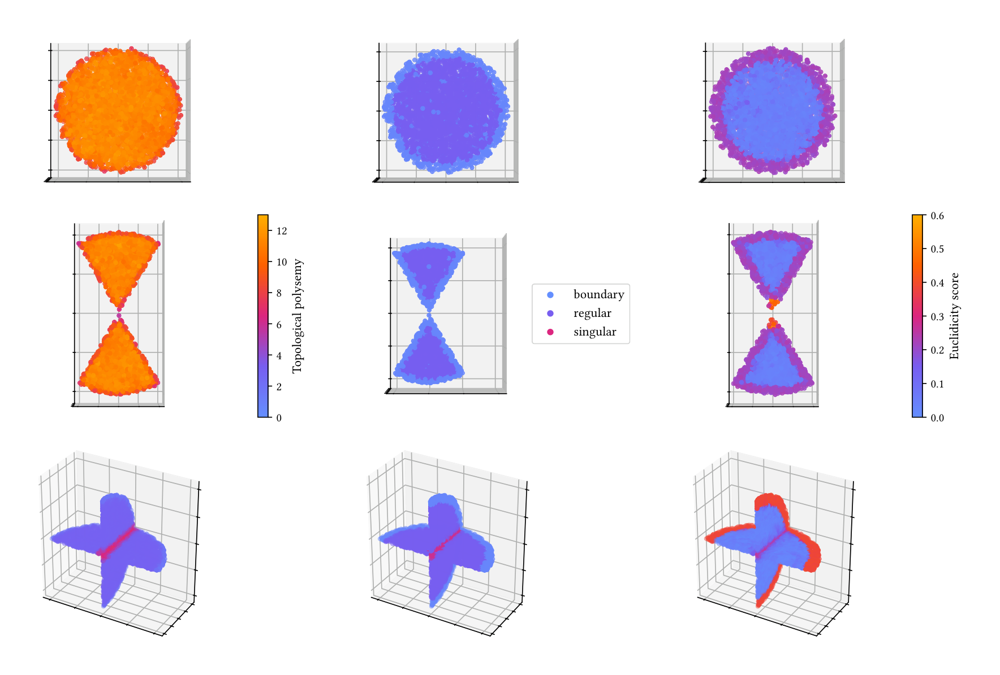
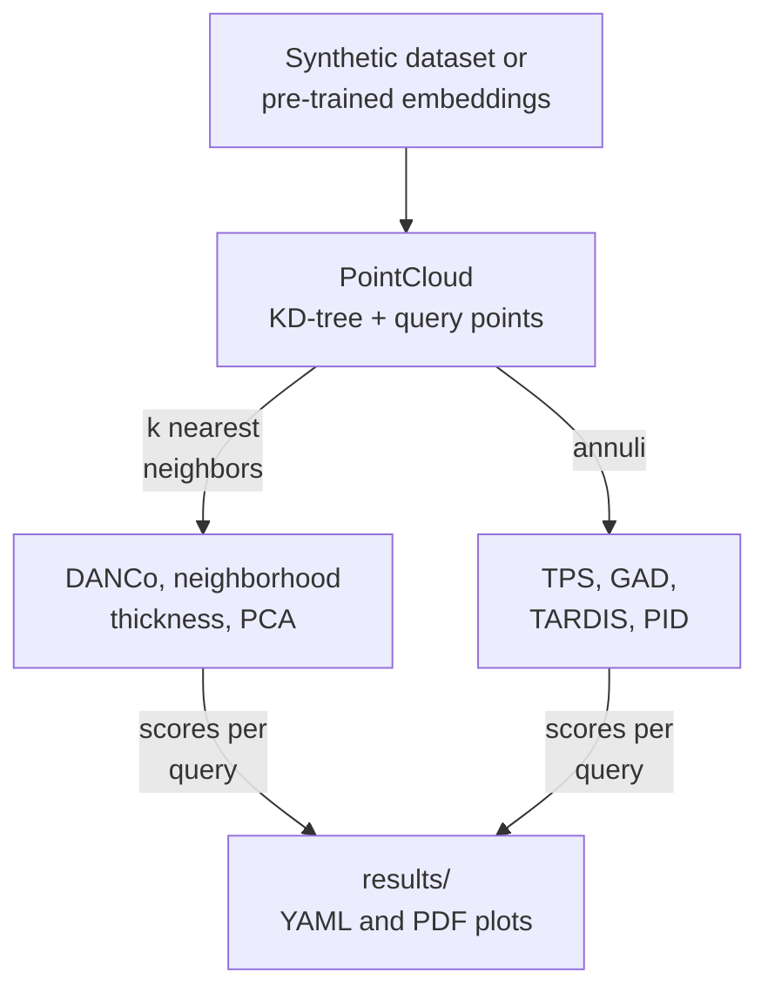
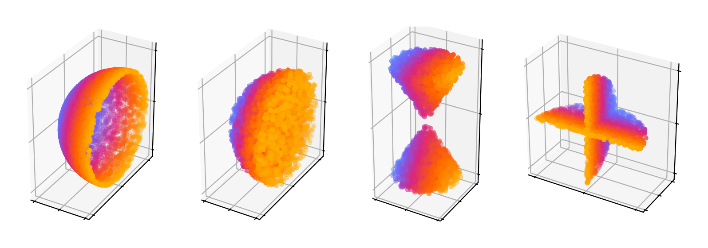

# An analysis of the effect of polysemy on the topology of the latent manifold




This repository holds the code behind my [master's thesis](https://research.tue.nl/en/studentTheses/an-analysis-of-the-effect-of-polysemy-on-the-topology-of-the-late/) at Eindhoven University of Technology (2024), which studies whether polysemes, words with several related meanings, show up as singular points among word embeddings. For it, I implemented three topology-based algorithms that detect singular points in point clouds, TPS [\[1\]](#ref-1), GAD [\[2\]](#ref-2) and TARDIS [\[3\]](#ref-3), in Python and applied them to Word2vec [\[4\]](#ref-4), fastText [\[5\]](#ref-5) and GloVe [\[6\]](#ref-6) embeddings. Every experiment script and plot behind the thesis is here too.

## Contents

- [Features](#features)
- [Tech stack](#tech-stack)
- [How it works](#how-it-works)
- [Getting started](#getting-started)
- [Project structure](#project-structure)
- [References](#references)
- [License](#license)

## Features

The code lets you:

- sample synthetic point clouds from spheres, balls, annuli, two intersecting cones and two intersecting planes, in any intrinsic and ambient dimension
- load the Word2vec [\[4\]](#ref-4), fastText [\[5\]](#ref-5) and GloVe [\[6\]](#ref-6) embedding sets, normalize them to unit length and filter out tokens that are numbers or unknown to WordNet [\[7\]](#ref-7)
- build a point cloud from the 60 query words in [`utils/words.csv`](utils/words.csv) and their nearest neighbors
- score points with TPS [\[1\]](#ref-1), classify them as regular, boundary or singular with GAD [\[2\]](#ref-2), and compute their Euclidicity scores with TARDIS [\[3\]](#ref-3)
- generate the annuli around each query point with the grid procedure from TARDIS [\[3\]](#ref-3) or with my proportion procedure, for all three algorithms
- estimate the local intrinsic dimension of a point with DANCo [\[8\]](#ref-8) or PID [\[3\]](#ref-3)
- measure the neighborhood thickness of a point and the variance explained by the principal components [\[9\]](#ref-9) of its neighborhood
- evaluate embedding sets on WordSim353 [\[10\]](#ref-10), [\[11\]](#ref-11) with Pearson and Spearman correlations
- save a point cloud with all its scores as YAML, and plot the scores in 3D or per word class
- rerun every experiment of the thesis, with one folder of scripts per thesis section

The methods process the query points in parallel with joblib, find neighbors with a KD-tree from scikit-learn and compute persistent homology with ripser.

## Tech stack

| Layer | Technologies |
| --- | --- |
| Language | Python 3.11 |
| Topology | ripser 0.6 (persistence diagrams), GUDHI 3 with POT (Wasserstein and bottleneck distances) |
| Intrinsic dimension | scikit-dimension 0.5 (DANCo [\[8\]](#ref-8)) |
| Embeddings and lexicon | Gensim 4, NLTK 3 (WordNet [\[7\]](#ref-7)) |
| Numerics | NumPy 1, SciPy 1, scikit-learn 1 (KD-tree, PCA [\[9\]](#ref-9)), pandas 3 |
| Parallelism | joblib 1 |
| Plots | Matplotlib 3 with LaTeX (Linux Libertine), SciencePlots 2 |

## How it works

Everything starts from a `PointCloud` in [`models/point_cloud.py`](models/point_cloud.py): a set of points, a KD-tree over them and a list of `Query` objects, one per point to analyze. The points come from a synthetic dataset or from a pre-trained embedding set. For each query, the cloud returns its `k` nearest neighbors or a set of annuli around it. A method takes the whole cloud, computes its score for every query in parallel and stores the score on the `Query`. It can then save the cloud as YAML, so plots can be redrawn without computing the persistent homology again.



A run is saved as one point cloud with its queries:

```mermaid
erDiagram
    POINT_CLOUD ||--o{ QUERY : "analyzes"
    POINT_CLOUD {
        ndarray points "all points, unit length for embeddings"
        KDTree tree "for neighbor and radius queries"
    }
    QUERY {
        int identifier PK
        ndarray point
        string word "set for embeddings only"
        string word_type "monoseme, interclass or intraclass polyseme"
        float intrinsic_dimension "from DANCo or PID"
        float topological_polysemy "TPS"
        string classification "GAD: regular, boundary or singular"
        float euclidicity "TARDIS"
        float original_neighborhood_thickness "largest angle in the neighborhood"
        ndarray neighborhood_variance "PCA explained variance ratios"
    }
```



### Methods

Each method is a module in [`methods/`](methods) with one entry point that takes a `PointCloud` and writes its result to every `Query`:

| Module | Entry point | Writes to `Query` | Source |
| --- | --- | --- | --- |
| [`topological_polysemy`](methods/topological_polysemy.py) | `calculate` | `topological_polysemy` | [\[1\]](#ref-1) |
| [`gad`](methods/gad.py) | `detect` | `classification` | [\[2\]](#ref-2) |
| [`euclidicity`](methods/euclidicity.py) | `calculate` | `euclidicity` | [\[3\]](#ref-3) |
| [`pid`](methods/intrinsic_dimension_estimators/pid.py) | `estimate` | `intrinsic_dimension` | [\[3\]](#ref-3) |
| [`danco`](methods/intrinsic_dimension_estimators/danco.py) | `estimate` | `intrinsic_dimension` | [\[8\]](#ref-8) |
| [`neighborhood_thickness`](methods/neighborhood_thickness.py) | `calculate` | `original_neighborhood_thickness` and `translated_neighborhood_thickness` |  |
| [`neighborhood_variance`](methods/neighborhood_variance.py) | `calculate` | `neighborhood_variance` | [\[9\]](#ref-9) |

`pid` and `danco` are in [`methods/intrinsic_dimension_estimators/`](methods/intrinsic_dimension_estimators).

- Every entry point takes an optional `filename_prefix`. With a prefix, it saves the cloud to `results/<prefix>_point_cloud.yaml`.
- GAD and Euclidicity read `query.intrinsic_dimension`, so run DANCo or PID first, or set it yourself.
- DANCo estimates the dimension once per neighborhood cardinality in a range, drops the lowest and highest 25% of the estimates and averages the rest.
- The annuli-based methods take `min_to_max_s_ratio`, `r_to_s_ratio` and `n_steps`. With both ratios set, `PointCloud.get_annuli` uses the proportion procedure. With either one left as `None`, it uses the grid procedure from TARDIS [\[3\]](#ref-3).
- `euclidicity.calculate` scales every annulus to an outer radius of 1 unless you pass `perform_scaling=False`.
- [`methods/tardis.py`](methods/tardis.py) is not one of the methods. It runs a local checkout of the [original TARDIS implementation](https://github.com/aidos-lab/TARDIS) through the Windows command prompt, and I only used it in [`exploration/`](exploration) to compare it with mine.

### Synthetic datasets

[`utils/sample_generation.py`](utils/sample_generation.py) samples points uniformly from spheres, balls, annuli, two intersecting cones and two intersecting planes, and pads them with zeros up to the ambient dimension you ask for.



## Getting started

### Prerequisites

- [Python](https://www.python.org/downloads/) 3.11
- A LaTeX distribution, such as [MiKTeX](https://miktex.org/) or [TeX Live](https://www.tug.org/texlive/), with the `libertine` and `libertinust1math` packages, because the plots render their text with LaTeX
- Windows, for the 14 scripts that play a sound with `winsound` when they finish: all of Chapter 7 and five scripts of Chapter 6. The other scripts run on any operating system.
- About 2.5 GB of free disk space for the repository, most of it the plots in `figures/`, and about 25 GB more if you download the embeddings

### 1. Clone the repository and install the dependencies

```bash
git clone https://github.com/denisshehu/MasterThesis.git
cd MasterThesis
python -m venv .venv
```

Activate the environment with `.venv\Scripts\activate` on Windows or `source .venv/bin/activate` on macOS and Linux. Then, in the repository folder, run:

```bash
pip install -r requirements.txt
python -m nltk.downloader wordnet words
```

[`requirements.txt`](requirements.txt) pins the versions I tested the code with. NLTK downloads WordNet [\[7\]](#ref-7), which is used to filter the embeddings.

### 2. Download the embeddings

You only need this step for the embedding evaluation and Chapter 7. The code reads three files from `embeddings/`:

| File | Embedding set | Source | Download |
| --- | --- | --- | --- |
| `word2vec.bin` | Word2vec trained on Google News, 3 million words | [\[4\]](#ref-4) | [word2vec archive](https://code.google.com/archive/p/word2vec/) |
| `fasttext.bin` | fastText `crawl-300d-2M-subword`, trained on Common Crawl | [\[5\]](#ref-5) | [fastText English vectors](https://fasttext.cc/docs/en/english-vectors.html) |
| `glove.txt` | GloVe `glove.42B.300d`, trained on Common Crawl | [\[6\]](#ref-6) | [GloVe on Hugging Face](https://huggingface.co/stanfordnlp/glove) |

On macOS or Linux, run this in the repository folder to download fastText and GloVe:

```bash
cd embeddings
curl -L -o fasttext.zip https://dl.fbaipublicfiles.com/fasttext/vectors-english/crawl-300d-2M-subword.zip
unzip -p fasttext.zip crawl-300d-2M-subword.bin > fasttext.bin
curl -L -o glove.zip https://huggingface.co/stanfordnlp/glove/resolve/main/glove.42B.300d.zip
unzip -p glove.zip glove.42B.300d.txt > glove.txt
rm fasttext.zip glove.zip
cd ..
```

On Windows, run this in PowerShell in the repository folder:

```powershell
cd embeddings
curl.exe -L -o fasttext.zip https://dl.fbaipublicfiles.com/fasttext/vectors-english/crawl-300d-2M-subword.zip
tar -xf fasttext.zip crawl-300d-2M-subword.bin
Rename-Item crawl-300d-2M-subword.bin fasttext.bin
curl.exe -L -o glove.zip https://huggingface.co/stanfordnlp/glove/resolve/main/glove.42B.300d.zip
tar -xf glove.zip glove.42B.300d.txt
Rename-Item glove.42B.300d.txt glove.txt
Remove-Item fasttext.zip, glove.zip
cd ..
```

Word2vec is hosted on Google Drive, so you download it by hand: get `GoogleNews-vectors-negative300.bin.gz` from the link on the [word2vec archive page](https://code.google.com/archive/p/word2vec/), extract it (with `gunzip` or 7-Zip) and save it as `embeddings/word2vec.bin`.

### 3. Run an experiment

Run every script from the repository folder, with the repository folder on the `PYTHONPATH`. On macOS or Linux:

```bash
PYTHONPATH=. python experiments/4-methodology/1_examples.py
```

On Windows, in PowerShell:

```powershell
$env:PYTHONPATH = "."
python experiments\4-methodology\1_examples.py
```

This samples the four synthetic datasets and saves `sphere.pdf`, `ball.pdf`, `cones.pdf` and `planes.pdf` in `results/`. Every script writes its point clouds (`*_point_cloud.yaml`) and plots (`*.pdf`) to `results/`.

About half of the scripts have the lines that build the point cloud and run the method commented out, and load a saved `results/<prefix>_point_cloud.yaml` instead. That's how I redrew plots without recomputing them. To run such a script from scratch, uncomment the construction and computation lines and comment out the `load_yaml` line.

### 4. Use the methods in your own code

This scores 1,000 random points on two intersecting planes with TPS [\[1\]](#ref-1). Run it from the repository folder, with the repository folder on the `PYTHONPATH` as in step 3:

```python
from methods import topological_polysemy
from models.point_cloud import PointCloud
from utils.sample_generation import sample_from_intersecting_planes

# 20,000 points on two intersecting 2-planes in 3D
points = sample_from_intersecting_planes(10000, 1, 10000, 1, 2, seed1=1, seed2=1, ambient_dimension=3)

point_cloud = PointCloud()
point_cloud.random_constructor(points, n_queries=1000, seed=1)

topological_polysemy.calculate(point_cloud, neighborhood_size=100, r_to_s_ratio=0.1)
scores = [query.topological_polysemy for query in point_cloud.queries]
```

### Experiments

| Thesis section | Scripts | What they do |
| --- | --- | --- |
| 4.1 | [`experiments/4-methodology/1_examples.py`](experiments/4-methodology/1_examples.py) | Sample and plot the four synthetic datasets |
| 4 | [`experiments/4-methodology/4_embedding_evaluation.py`](experiments/4-methodology/4_embedding_evaluation.py) | Evaluate the three embedding sets on WordSim353 [\[10\]](#ref-10), [\[11\]](#ref-11) (not shown in the thesis) |
| 5.2 | [`experiments/5-adaptation/2-tardis`](experiments/5-adaptation/2-tardis) | Compute Euclidicity scores of TARDIS [\[3\]](#ref-3) with and without scaling of annuli |
| 5.3 | [`experiments/5-adaptation/3-intrinsic-dimension`](experiments/5-adaptation/3-intrinsic-dimension) | Estimate the intrinsic dimension of balls with PID [\[3\]](#ref-3) and DANCo [\[8\]](#ref-8) |
| 6.2 | [`experiments/6-synthetic-datasets/2-tps`](experiments/6-synthetic-datasets/2-tps) | Tune and evaluate TPS [\[1\]](#ref-1) on the synthetic datasets |
| 6.3 | [`experiments/6-synthetic-datasets/3-gad`](experiments/6-synthetic-datasets/3-gad) | Tune and evaluate GAD [\[2\]](#ref-2) on the synthetic datasets |
| 6.4 | [`experiments/6-synthetic-datasets/4-tardis`](experiments/6-synthetic-datasets/4-tardis) | Tune and evaluate TARDIS with both annuli procedures, filterings and wrong intrinsic dimensions |
| 7.2 | [`experiments/7-word-embeddings/2-neighborhood-thickness`](experiments/7-word-embeddings/2-neighborhood-thickness) | Measure the neighborhood thickness of the query words |
| 7.3 | [`experiments/7-word-embeddings/3-pca`](experiments/7-word-embeddings/3-pca) | Compute the variance explained by the principal components [\[9\]](#ref-9) of their neighborhoods |
| 7.4 | [`experiments/7-word-embeddings/4-tps`](experiments/7-word-embeddings/4-tps) | Apply TPS to the query words |
| 7.5 | [`experiments/7-word-embeddings/5-intrinsic-dimension`](experiments/7-word-embeddings/5-intrinsic-dimension) | Estimate their intrinsic dimension with DANCo |
| 7.6 | [`experiments/7-word-embeddings/6-gad`](experiments/7-word-embeddings/6-gad) | Apply GAD to the query words |
| 7.7 | [`experiments/7-word-embeddings/7-tardis`](experiments/7-word-embeddings/7-tardis) | Apply TARDIS to the query words |

In Chapter 6, the numbered scripts run the parameter sweeps first, then the 2D and 3D datasets and then higher dimensions. For GAD and TARDIS, the last script tests the intrinsic dimension estimate. The plots they produced are in [`figures/`](figures), in folders with the same names. In Chapter 7, the `thesis` subfolders hold the exact plots that appear in the thesis.

## Project structure

```text
MasterThesis/
├── docs/figures/       # images shown in this README
├── embeddings/         # pre-trained embeddings you download (not committed)
├── evaluation/         # WordSim353 files and the embedding evaluation
├── experiments/        # one folder of scripts per thesis section
├── exploration/        # notebooks I used to develop and debug the methods
├── figures/            # every plot the experiments produced, by thesis section
├── methods/
│   ├── intrinsic_dimension_estimators/   # DANCo and PID
│   ├── euclidicity.py                    # TARDIS
│   ├── gad.py                            # GAD
│   ├── topological_polysemy.py           # TPS
│   ├── neighborhood_thickness.py
│   ├── neighborhood_variance.py          # PCA
│   └── tardis.py       # runs the original TARDIS, for comparison
├── models/             # PointCloud (neighborhoods, annuli) and Query
├── results/            # output of the experiments (not committed)
└── utils/              # sampling, storage, plotting and the word list
```

## References

1. <a name="ref-1"></a>Alexander Jakubowski, Milica Gašić, and Marcus Zibrowius. [Topology of Word Embeddings: Singularities Reflect Polysemy](https://aclanthology.org/2020.starsem-1.11/). In *Proceedings of the Ninth Joint Conference on Lexical and Computational Semantics*, pages 103–113, 2020.
2. <a name="ref-2"></a>Bernadette Stolz, Jared Tanner, Heather Harrington, and Vidit Nanda. [Geometric anomaly detection in data](https://doi.org/10.1073/pnas.2001741117). *Proceedings of the National Academy of Sciences*, 117(33):19664–19669, 2020.
3. <a name="ref-3"></a>Julius von Rohrscheidt and Bastian Rieck. [Topological Singularity Detection at Multiple Scales](https://proceedings.mlr.press/v202/von-rohrscheidt23a.html). In *Proceedings of the International Conference on Machine Learning 2023*, volume 202 of *Proceedings of Machine Learning Research*, pages 35175–35197, 2023.
4. <a name="ref-4"></a>Tomás Mikolov, Kai Chen, Greg Corrado, and Jeffrey Dean. [Efficient Estimation of Word Representations in Vector Space](https://arxiv.org/abs/1301.3781). In *Proceedings of the First International Conference on Learning Representations*, 2013.
5. <a name="ref-5"></a>Tomás Mikolov, Edouard Grave, Piotr Bojanowski, Christian Puhrsch, and Armand Joulin. [Advances in Pre-Training Distributed Word Representations](https://aclanthology.org/L18-1008/). *Proceedings of the Eleventh International Conference on Language Resources and Evaluation*, 2018.
6. <a name="ref-6"></a>Jeffrey Pennington, Richard Socher, and Christopher Manning. [GloVe: Global Vectors for Word Representation](https://aclanthology.org/D14-1162/). In *Proceedings of the 2014 Conference on Empirical Methods in Natural Language Processing*, pages 1532–1543, 2014.
7. <a name="ref-7"></a>Princeton University. [Princeton University “About WordNet.”](https://wordnet.princeton.edu/), 2010.
8. <a name="ref-8"></a>Claudio Ceruti, Simone Bassis, Alessandro Rozza, Gabriele Lombardi, Elena Casiraghi, and Paola Campadelli. [DANCo: An intrinsic dimensionality estimator exploiting angle and norm concentration](https://doi.org/10.1016/j.patcog.2014.02.013). *Pattern Recognition*, 47(8):2569–2581, 2014.
9. <a name="ref-9"></a>Karl Pearson. [LIII. On lines and planes of closest fit to systems of points in space](https://doi.org/10.1080/14786440109462720). *The London, Edinburgh, and Dublin Philosophical Magazine and Journal of Science*, 2(11):559–572, 1901.
10. <a name="ref-10"></a>Lev Finkelstein, Evgeniy Gabrilovich, Yossi Matias, Ehud Rivlin, Zach Solan, Gadi Wolfman, and Eytan Ruppin. [Placing search in context: the concept revisited](https://doi.org/10.1145/503104.503110). *ACM Transactions on Information Systems*, 20(1):116–131, 2002.
11. <a name="ref-11"></a>Eneko Agirre, Enrique Alfonseca, Keith Hall, Jana Kravalova, Marius Paşca, and Aitor Soroa. [A Study on Similarity and Relatedness Using Distributional and WordNet-based Approaches](https://aclanthology.org/N09-1003/). In *Proceedings of Human Language Technologies: The 2009 Annual Conference of the North American Chapter of the Association for Computational Linguistics*, pages 19–27, 2009.

## License

This project is licensed under the [MIT License](LICENSE).
